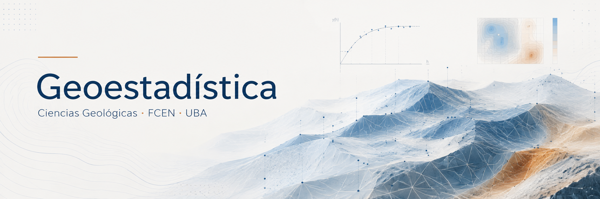

# Manual de Geoestadística {.unnumbered .titulo-estructural}

::: {.portada-manual}

{.portada-imagen fig-alt="Geoestadística - Ciencias Geológicas FCEN UBA"}

[Fundamentos teóricos y ejemplos geológicos]{.portada-titulo}

[Manual en construcción para la materia de Geoestadística]{.portada-subtitulo}

::: {.portada-metadata}

::: {.portada-item}
[DOCENTES]{.portada-label}

[Docentes de Geoestadística]{.portada-valor}
:::

::: {.portada-item}
[FECHA DE PUBLICACIÓN]{.portada-label}

[14 de agosto de 2026]{.portada-valor}
:::

:::

:::

# Propósito {.unnumbered}

Este manual desarrolla progresivamente las ideas fundamentales que conducen hacia la geoestadística: comienza con problemas de descripción de datos, muestreo, probabilidad e inferencia, y avanza hacia el estudio de relaciones entre variables, la dependencia espacial, el variograma y la estimación por kriging.

La pregunta que organiza el recorrido es sencilla: **¿qué cambia cuando, además del valor observado, importa dónde fue observado?** Antes de responderla necesitamos comprender qué puede —y qué no puede— decir la estadística clásica sobre una muestra.

## Un caso conductor

A lo largo del texto volveremos sobre concentraciones de arsénico medidas en pozos de agua subterránea de la provincia de Buenos Aires. El caso permite avanzar por capas:

- describir una muestra de concentraciones;
- estudiar su distribución y sus valores extremos;
- comparar muestras y discutir representatividad;
- incorporar las coordenadas de cada pozo;
- reconocer continuidad, anisotropía y escalas espaciales;
- estimar en lugares no muestreados y cuantificar incertidumbre bajo un modelo;
- comparar muestras multivariadas e identificar agrupamientos exploratorios.

Los datos reales definitivos, su procedencia y sus condiciones de uso se documentarán antes de incorporarlos. Mientras tanto, los ejemplos reproducibles utilizan una población sintética de 1000 pozos para mantener continuidad entre capítulos sin atribuir valores a localizaciones reales.

## Reproducibilidad

Las figuras que representen resultados numéricos se generarán, siempre que sea posible, mediante código Python incluido junto al texto. Los bloques están pensados para ejecutarse en Jupyter o Google Colab utilizando bibliotecas de uso extendido. Cuando una ilustración requiera diseño manual o una fuente externa todavía no disponible, el texto mostrará un marcador explícito con su propósito y contenido esperado.

## Estado actual del manual

Esta versión cubre datos y muestreo; estadística descriptiva; probabilidad e inferencia; pruebas de hipótesis; comparación de varianzas y frecuencias categóricas; correlación y regresión lineal; dependencia espacial; variograma experimental y modelos; anisotropía; IDW y kriging ordinario; incertidumbre, soporte y validación espacial; transformaciones; semejanza multivariada; agrupamiento jerárquico; $k$-means; análisis de componentes principales; y aplicaciones a familias de fracturas, circones detríticos y aguas geotérmicas.

A lo largo de los capítulos se refuerza una idea central: la información depende del diseño, del soporte y de la estructura de dependencia. El variograma formaliza cómo cambia la disimilitud con la separación; kriging utiliza ese modelo y la geometría de las observaciones para estimar y cuantificar incertidumbre.

Los capítulos visibles buscan ser autosuficientes y revisables. Los temas que todavía no forman parte del tramo publicado no se reemplazan por capítulos vacíos ni apuntes incompletos.

## Alcance

El libro combina tres niveles de lectura:

- una narrativa conceptual, accesible sin seguir la clase;
- formulaciones matemáticas con supuestos explícitos;
- ejemplos reproducibles que conectan la teoría con problemas geológicos.

No pretende reemplazar las fuentes bibliográficas especializadas. Su función es construir un camino coherente hacia ellas y conservar la lógica didáctica de la materia a medida que evoluciona.

## Teoría y práctica

El orden de los temas sigue la cronología de la materia. Los ejemplos computacionales adoptan la filosofía de los libros prácticos reproducibles: código visible, datos accesibles o generados de manera transparente, semillas fijas y una interpretación junto a cada resultado. Esta decisión está inspirada, entre otros recursos educativos abiertos, por el enfoque de @pyrcz_2024, pero el desarrollo, los ejemplos y la secuencia de este manual son propios de la materia.
